<picture><source media="(prefers-color-scheme: dark)" srcset="assets/hero-dark.svg">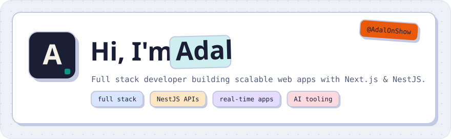</picture>

<a href="https://nextjs.org"><picture><source media="(prefers-color-scheme: dark)" srcset="assets/skill-nextjs-dark.svg"></picture></a>
<a href="https://nestjs.com"><picture><source media="(prefers-color-scheme: dark)" srcset="assets/skill-nestjs-dark.svg"></picture></a>
<a href="https://www.typescriptlang.org"><picture><source media="(prefers-color-scheme: dark)" srcset="assets/skill-typescript-dark.svg">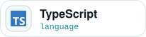</picture></a>
<a href="https://www.postgresql.org"><picture><source media="(prefers-color-scheme: dark)" srcset="assets/skill-postgresql-dark.svg"></picture></a>

<picture><source media="(prefers-color-scheme: dark)" srcset="assets/github-dark.svg">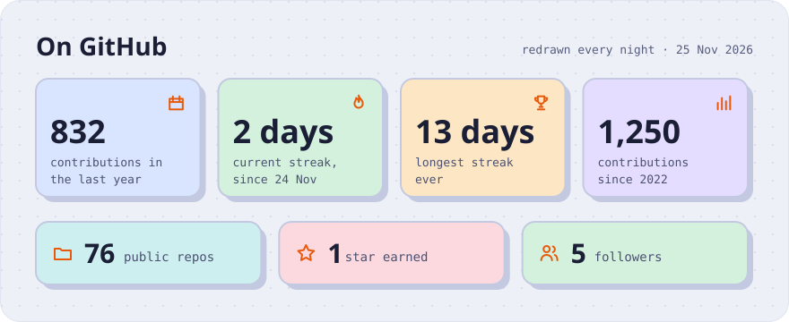</picture>

<picture><source media="(prefers-color-scheme: dark)" srcset="assets/graph-6m-dark.svg">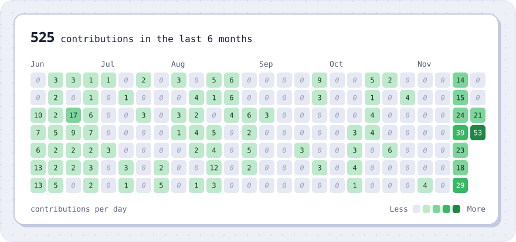</picture>

<!-- years:start -->

Last 12 months: 830 contributions

<picture><source media="(prefers-color-scheme: dark)" srcset="assets/graph-12m-dark.svg">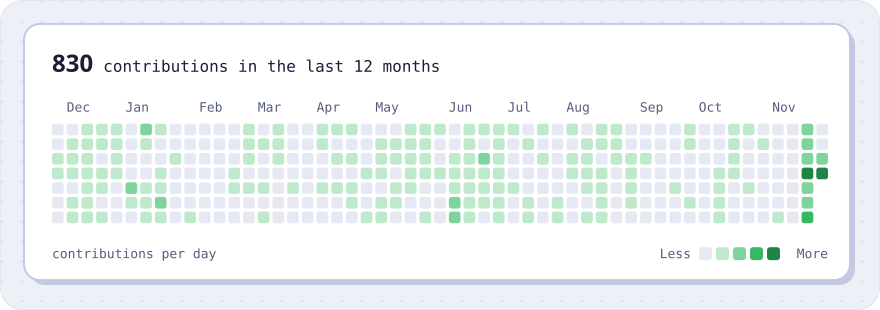</picture>

2026: 724 contributions

<picture><source media="(prefers-color-scheme: dark)" srcset="assets/graph-2026-dark.svg">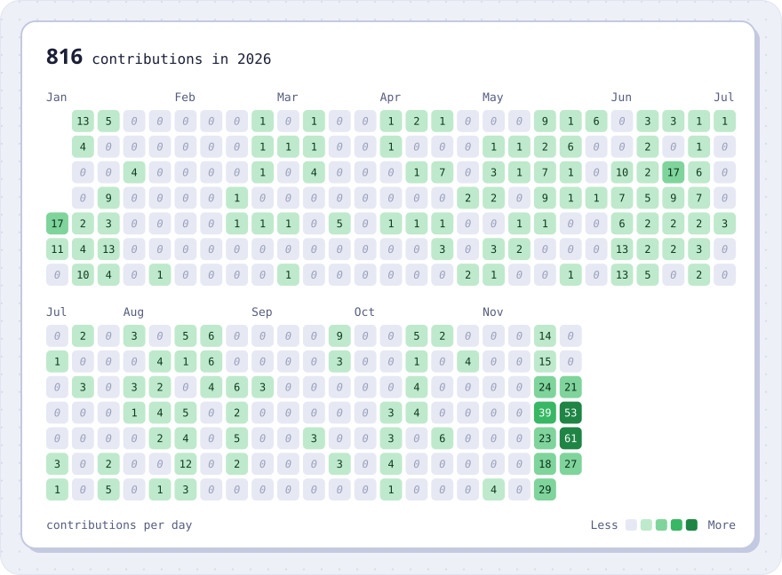</picture>

2025: 318 contributions

<picture><source media="(prefers-color-scheme: dark)" srcset="assets/graph-2025-dark.svg">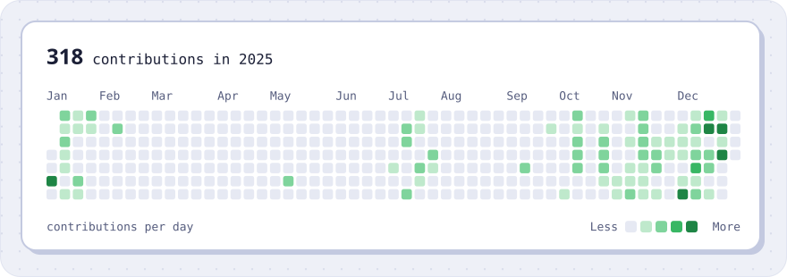</picture>

2024: 201 contributions

<picture><source media="(prefers-color-scheme: dark)" srcset="assets/graph-2024-dark.svg">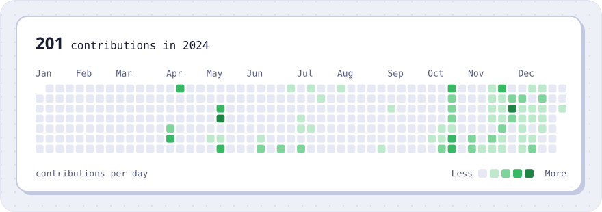</picture>

2023: 4 contributions

<picture><source media="(prefers-color-scheme: dark)" srcset="assets/graph-2023-dark.svg">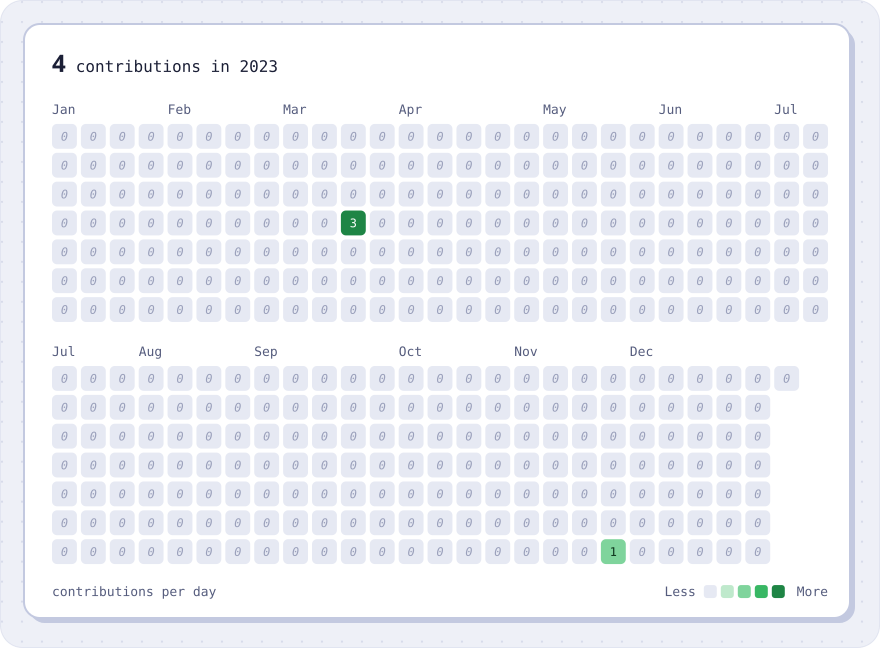</picture>

2022: 1 contribution

<picture><source media="(prefers-color-scheme: dark)" srcset="assets/graph-2022-dark.svg">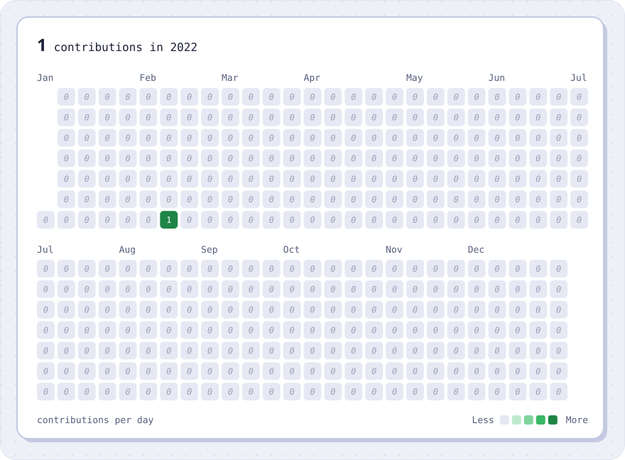</picture>

<!-- years:end -->

<picture><source media="(prefers-color-scheme: dark)" srcset="assets/line-30d-dark.svg">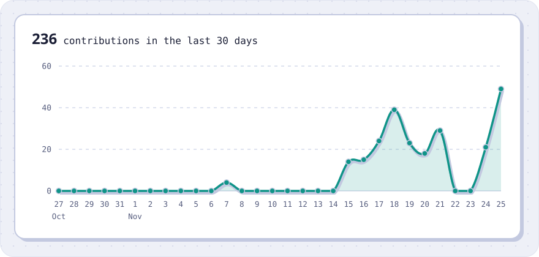</picture>

<picture><source media="(prefers-color-scheme: dark)" srcset="assets/whoami-dark.svg">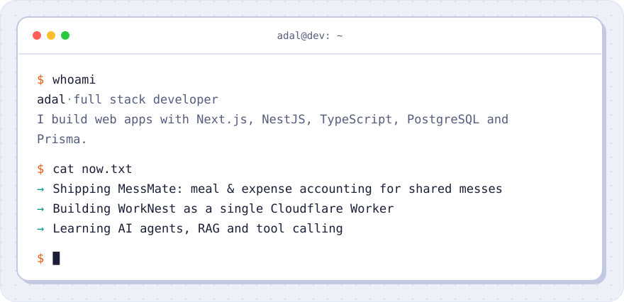</picture>

<picture><source media="(prefers-color-scheme: dark)" srcset="assets/label-build-dark.svg">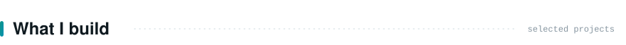</picture>

<a href="https://messmate.sadal.dev/"><picture><source media="(prefers-color-scheme: dark)" srcset="assets/project-messmate-dark.svg">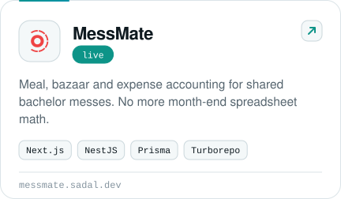</picture></a>
<a href="https://worknest.sadal.dev/"><picture><source media="(prefers-color-scheme: dark)" srcset="assets/project-worknest-dark.svg">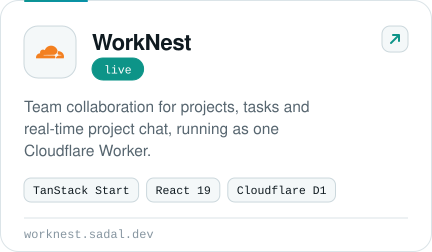</picture></a>
<!-- Hidden for now:
<a href="https://itemhub-frontend.vercel.app/"><picture><source media="(prefers-color-scheme: dark)" srcset="assets/project-itemhub-dark.svg">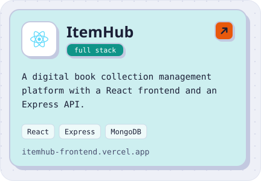</picture></a>
<a href="https://github.com/AdalOnShow/company-chatbot"><picture><source media="(prefers-color-scheme: dark)" srcset="assets/project-company-chatbot-dark.svg">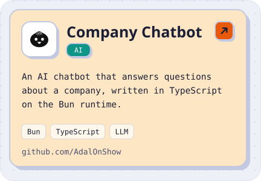</picture></a>
-->

more: <a href="https://github.com/AdalOnShow/WorkNest-frontend">WorkNest (Next.js + Express)</a> · <a href="https://github.com/AdalOnShow/expo-roam">expo-roam</a> · <a href="https://github.com/AdalOnShow/nest-advanced-learning">nest-advanced-learning</a> · <a href="https://github.com/AdalOnShow/rag-learning-project-1">rag-learning</a>

<!-- Snake animation, hidden for now:
<picture>
  <source media="(prefers-color-scheme: dark)" srcset="https://raw.githubusercontent.com/adalonshow/adalonshow/output/github-snake-dark.svg" />
  
</picture>
-->

Cards drawn by <code>scripts/generate.mjs</code> · numbers redrawn every night by a GitHub Action · 

